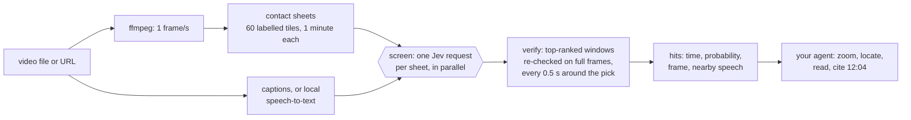

# jevreel

**A zero-embedding approach to video intelligence, using Jev.**

[](https://github.com/DeepAleph/jevreel/actions/workflows/ci.yml)
[](https://github.com/DeepAleph/jevreel/blob/main/LICENSE)


<!-- mcp-name: io.github.DeepAleph/jevreel -->

jevreel lays a video out on labelled contact sheets, one frame per second and sixty frames to an
image, and has [Jev](https://docs.typesafe.ai), TypeSafe's fast decision model, judge every sheet in
parallel. The best windows are re-checked on full frames. Your agent (Claude Code, Codex, Cursor,
Claude Desktop, anything that speaks MCP) gets back moments, times and probabilities, then looks
closer itself. No vectors are computed or stored anywhere.

<a href="https://github.com/DeepAleph/jevreel/blob/main/docs/demo/clips/intro.mp4"></a>

## See it work

Five unedited Claude Code sessions using the jevreel MCP server and skill on Blender's open movie
[*Tears of Steel*](https://mango.blender.org) (12:14, (CC) Blender Foundation,
[CC BY 3.0](https://creativecommons.org/licenses/by/3.0/)). Each clip is drawn from its
recording: the agent's tool calls, what Jev answered for every sheet and frame, the hits, the cost,
and the agent's own answer, quoted. Click a clip for the full-resolution video.

| | Asked | What happened | Jev |
| - | - | - | - |
| 1 | Is there a moment where someone drinks from a juice box? | 13 sheets screened, 6 windows verified on full frames, 2 kept: **2:28.5** (p 0.95) and 12:06.5 (0.86) | 19 requests, $0.0054 |
| 2 | When does Thom apologise to Celia, and what does he say? | Speech mode over the captions: 6:47 *"I'm sorry."* (0.85), and a blurted *"Sorry!"* at 5:02 the agent set aside | 10 requests, $0.0003 |
| 3 | Somebody reads a newspaper early on. What does the headline say? | First 5 minutes only: verified at **1:20.5** (0.94); the agent read *ROBOTICIST CREATES KILLER ROBOTS* off the frame | 8 requests, $0.0024 |
| 4 | `captain.jpg` is a character. List every scene he's in. | Search by photo: 8 moments, 6 verified at 0.86–0.97, 2 more confirmed by the agent with `zoom` | 19 requests, $0.0064 |
| 5 | Map the film: robots, guns, holograms, settings, and what kind of film. | The agent wrote its own 4-question lens, read the per-minute rows back for free, and asked one whole-film question | 14 requests, $0.0051 |

### 1. Find a three-second moment

<a href="https://github.com/DeepAleph/jevreel/blob/main/docs/demo/clips/a-juice.mp4"></a>

### 2. Search the dialogue

<a href="https://github.com/DeepAleph/jevreel/blob/main/docs/demo/clips/b-apology.mp4"></a>

### 3. Read what's on screen

<a href="https://github.com/DeepAleph/jevreel/blob/main/docs/demo/clips/c-newspaper.mp4"></a>

### 4. Find a person from a photo

<a href="https://github.com/DeepAleph/jevreel/blob/main/docs/demo/clips/d-captain.mp4"></a>

The reference photo is a crop of the frame at 9:18, so the 9:17 hit is its own source; the other
seven are what the search found.

### 5. Map a whole film

<a href="https://github.com/DeepAleph/jevreel/blob/main/docs/demo/clips/e-map.mp4"></a>

The session starts with two failed calls, left in: a shell command the recording didn't allow, then
a wrong folder. The error names the folder relative paths resolve from, and the next call works.

## Why a decision model instead of embeddings

Multimodal embedding models already search video well: EmbeddingGemma 2 (October 2026) puts text,
images, video frames and audio in one vector space and runs on a phone. jevreel takes a different
route to the same goal, with different trade-offs.

- **Your question, not a fixed notion of "similar".** An embedding index decides at index time what
  counts as close. A decision model judges the question you ask now, and returns a probability your
  code can threshold, sort and gate on.
- **Every second, cheaply.** Jev charges for input tokens only, and output is free. A contact sheet
  is sent once and every question about it rides along in the same request, so jevreel screens the
  whole video at one frame per second instead of a handful of keyframes.
- **Questions are nearly free, so ask many.** Lenses add your own typed questions to every minute
  at almost no extra cost, then filter them as often as you like for nothing.
- **The expensive model only sees what passed.** Your agent gets the few moments that matter, as
  full-resolution frames, rather than a pile of thumbnails.
- **Typed answers, not just rankings.** Yes/no with the second it happens, one of your options, or a
  level on your scale, per minute or for the whole video.

Embeddings are the better fit for querying a large library over and over: once the vectors exist,
each search is a lookup that costs nothing, while every jevreel question pays Jev for the minutes it
screens (about $0.02–0.03 per hour of video). The two combine well: embeddings to shortlist
videos, jevreel to find, verify and describe the moment.

## How it works



1. **Index.** Sample the video at 1 fps and tile the frames onto 1568 px contact sheets, each tile
   labelled `T01`, `T02`, and so on. Fetch captions, or transcribe locally. Ask every sheet a fixed
   set of questions once (people, on-screen text, cuts, setting, activity, a representative frame)
   plus any **lenses** you add, which gives a typed timeline.
2. **Screen.** One request per sheet: a yes/no (Noul) for "is it in this minute" plus a Choice over
   tile IDs for "which second". Screen and speech are separate questions combined in code.
3. **Verify.** The top-ranked windows (by rank, not threshold) are re-checked with one yes/no per full
   frame, every half second around the pick. Screening ranks a one-second event correctly even when
   it can't confirm it; verification confirms it, or throws out a false lead.
4. **Look closer.** `zoom` re-renders full-resolution frames; `locate` puts a Box around a target in
   one frame and crops it; `whole` answers one question about the entire video from a storyboard,
   the timeline and the transcript.

Answers are cached: the same images and questions to the same model never cost twice.

This follows TypeSafe's own patterns. Their line-search cookbook pairs a Choice over labelled units
with a Noul for "is it there at all". Their images guide searches a large image by Choice over tiles
and looks closer only where needed. Their Box guide gates every box behind a Noul and checks its edges.

## Quickstart

You need Python 3.11+, [FFmpeg](https://ffmpeg.org/download.html) on your PATH, and a
[TypeSafe API key](https://console.typesafe.ai).

```bash
uv tool install "jevreel[all]"
export TYPESAFE_API_KEY=...

jevreel index talk.mp4                       # prints the video id
jevreel ask talk "a slide with a bar chart"  # id, id prefix, path or title all work
jevreel zoom talk 12:00 12:10                # full-resolution frames to look at
```

`[all]` adds URL support (yt-dlp) and local speech-to-text (faster-whisper). Without them, jevreel
indexes local files and uses `.srt` or `.vtt` captions saved next to the video.

## Lenses: your own questions on every minute

A lens is a set of typed questions asked of every sheet and kept as timeline columns. Questions can
be `noul` (yes/no, plus the second it happens), `choice` (one of your options) or `score` (levels,
lowest first).

```toml
# examples/lenses/driving.toml
name = "driving"

[[questions]]
name = "on_bridge"
type = "noul"
ask = "Is the car driving on a bridge?"

[[questions]]
name = "weather"
type = "choice"
ask = "What is the weather mostly like?"
options = ["clear", "cloudy", "rain", "snow", "fog"]

[[questions]]
name = "traffic"
type = "score"
ask = "How much other traffic is on the road?"
levels = ["None", "Light", "Moderate", "Heavy"]
```

```bash
jevreel index drive.mp4 --lens driving.toml     # rides in the indexing requests: almost free
jevreel lens drive driving.toml                 # or run it later: one request per minute of video
jevreel query drive "on_bridge > 0.7"           # filter as often as you like: no requests
jevreel query drive "weather == snow and traffic >= 2"
```

## Use it from your agent

The MCP server exposes ten tools. The skill teaches agents the workflow: ask, look before claiming
anything, cite times.

### As a plugin

The plugin bundles the MCP server and the skill. It starts the server with
`uvx --from "jevreel[url]==0.2.0"`, so you need [uv](https://docs.astral.sh/uv/) and FFmpeg on
your PATH. Local speech-to-text is left out to keep the first start quick; for it, add the server
by hand with `jevreel[all]` as shown further down.

**Claude Code** asks for your TypeSafe API key when you enable the plugin and keeps it in your
system's credential store:

```bash
claude plugin marketplace add DeepAleph/jevreel
claude plugin install jevreel@jevreel
```

**Codex** passes plugin servers only an allowlist of environment variables, so save the key once.
The same command installs the environment the plugin starts, so its first start is fast:

```bash
uvx --from "jevreel[url]==0.2.0" jevreel login
codex plugin marketplace add DeepAleph/jevreel
codex plugin add jevreel@jevreel
```

### By hand

**Claude Code**

```bash
claude mcp add jevreel -e TYPESAFE_API_KEY=your-key -- uvx --from "jevreel[all]" jevreel mcp
```

**Codex**

```bash
codex mcp add jevreel --env TYPESAFE_API_KEY=your-key -- uvx --from "jevreel[all]" jevreel mcp
```

**Claude Desktop, Cursor and other `mcpServers` clients**

```json
{
  "mcpServers": {
    "jevreel": {
      "command": "uvx",
      "args": ["--from", "jevreel[all]", "jevreel", "mcp"],
      "env": { "TYPESAFE_API_KEY": "your-key" }
    }
  }
}
```

VS Code uses the same entry under `"servers"` with `"type": "stdio"`.

**The skill** (Claude Code, Codex and other agents that read Agent Skills):

```bash
npx skills add DeepAleph/jevreel
```

Agents without MCP can use the skill with the CLI alone; every command prints JSON.

## Tools

| MCP tool | CLI | What it does |
| - | - | - |
| `index_video` | `jevreel index` | Sheets, transcript, typed timeline and any lenses. Runs as an MCP background task; repeat calls return the index and only run new lenses. |
| `ask_video` | `jevreel ask` | Moments matching a description: screened, verified on full frames, with times, probabilities, nearby speech and the frames themselves. `mode`: visual, speech, both. |
| `find_in_video` | `jevreel find` | Every moment the subject of a reference photo appears. |
| `locate_in_frame` | `jevreel locate` | Box and crop a target in one full-resolution frame. |
| `zoom_video` | `jevreel zoom` | Evenly spaced full-resolution frames between two times. |
| `video_transcript` | `jevreel transcript` | What is said between two times. |
| `ask_whole_video` | `jevreel whole` | One typed answer (yes/no, choice, or score) about the entire video. |
| `run_lens` | `jevreel lens` | Ask your own typed questions of every minute of an indexed video. |
| `query_timeline` | `jevreel query` | Filter the timeline (default answers and lenses). No requests. |
| `list_videos` | `jevreel list` | Videos indexed on this machine. |

`jevreel measure <video>` reports what one contact sheet costs at several grid sizes on your account.

## Python

```python
import asyncio

from jevreel import Reel


async def main() -> None:
    async with Reel() as reel:
        video = await reel.index("talk.mp4")
        result = await reel.ask(video.id, "a slide with a bar chart")
        for hit in result.hits:
            print(hit.time, hit.probability, hit.frame)
        print(reel.query(video.id, "text_on_screen > 0.8").rows)


asyncio.run(main())
```

## Configuration

| Variable | Default | Meaning |
| - | - | - |
| `TYPESAFE_API_KEY` | (required for Jev) | Your TypeSafe key. Indexing without a timeline, zoom, transcripts and queries work without it. |
| `JEVREEL_HOME` | your user cache folder | Where indexed videos, sheets, frames and the answer cache are kept. `jevreel home` prints it. |
| `JEVREEL_MODEL` | `jev-1.14.0` | Pinned on purpose: Box and image tiles need 1.14, and aliases move. |
| `JEVREEL_FPS` | `1` | Frames per second sampled onto sheets (up to 5). |
| `JEVREEL_TILES_PER_SHEET` | `60` | Frames per sheet. Fewer means larger tiles and more requests. |
| `JEVREEL_VERIFY_TOP` | `6` | How many top-ranked windows each ask verifies on full frames; `0` turns verification off. |
| `JEVREEL_CACHE` | `1` | Set to `0` to always ask Jev again. |
| `JEVREEL_CONCURRENCY` | `16` | Parallel Jev requests. Rate limits are per TypeSafe account. |
| `JEVREEL_ASR_MODEL` | `small` | faster-whisper model for videos without captions. |
| `JEVREEL_CAPTION_LANGUAGES` | `en,en-orig,en.*` | Caption languages to fetch for URLs, in order. |

## What it costs

Measured on 2026-10-15 with `jev-1.14.0` at $0.042 per million input tokens, on a 10-minute 1080p video:

| | Requests | Input tokens | Cost |
| - | - | - | - |
| One full contact sheet (any grid from 4×7 to 8×14) | 1 | about 6,000 | $0.00025 |
| Indexing (11 sheets, 8 default questions each, 14 s wall clock) | 11 | 78,000 | $0.0033 |
| A lens of 5 questions, run afterwards | 11 | 84,000 | $0.0035 |
| One `ask`, screened and verified | 13–15 | 97,000–115,000 | $0.004–0.005 |
| The same `ask` again | 0 | 0 | $0 (cache) |
| `locate` (Box plus edge check) | 2 | 5,000 | $0.0002 |
| `whole` (one storyboard request) | 1 | 7,600 | $0.0003 |

One question across an hour of video comes to about $0.02–0.03. Asked at index time, lens questions
ride along with the default ones, which is where the "nearly free" comes from: an 8-question request
cost about the same as a 2-question one. TypeSafe doesn't document image token counts yet. These
figures are what the API reported. Check yours with `jevreel measure`.

## Measured on a real video

A 10-minute 1080p gameplay capture, no speech, every result checked against the frames by hand:

| Query | Result |
| - | - |
| "the game's pause menu is open" | All three appearances, each under a second: 0:08.5, 2:19.5, 10:12.5 (p 0.99–1.00). Screening alone scored them 0.36, 0.50, 0.95. Before verification, two of the three were missed. |
| "the full-screen city map is shown" | 0:10 and 2:21, both map screens. No false hits. |
| "the car drives across a big steel truss bridge" | 2:07 and 5:05.5, both real bridge crossings. |
| Lens `driving`: `query "on_bridge > 0.7"` | Exactly the two bridge minutes, at 2:14 and 5:02. |
| Lens `driving`: `query "menu_open > 0.7"` | Exactly the three menu minutes. |
| `locate` "the location name caption" at 5:02 | Boxed and cropped; the crop reads "Fathers Bridge". |
| `whole` "What is this video mostly?" | "a driving sequence in a video game", 0.98. |

## Limits

- **Brief events need screening to rank their window.** Verification looks every half second, but
  only in the top-ranked windows (6 by default). An event that screening ranks below that is not
  checked. Raise `JEVREEL_VERIFY_TOP`, or lower `JEVREEL_TILES_PER_SHEET` for larger tiles.
- **No sound beyond speech.** Audio reaches Jev only as transcript text.
- **Jev's image support is experimental.** TypeSafe calls images and Box "dreamer-ready", not
  production-ready, and says limits and accuracy can change between releases.
- **Jev's real image minimum is 280 px per side.** The docs say 256, but the API rejects anything
  smaller than 280 (measured 2026-10-15). jevreel pads every image itself.
- **Thresholds need tuning on your footage.** 0.5 to report and 0.7 for "strong" follow TypeSafe's
  examples. They held up on the test video, which is one video.

## Contributing

Issues and pull requests are welcome. See [CONTRIBUTING.md](https://github.com/DeepAleph/jevreel/blob/main/CONTRIBUTING.md). Coding agents should read
[AGENTS.md](https://github.com/DeepAleph/jevreel/blob/main/AGENTS.md).

## License

[MIT](https://github.com/DeepAleph/jevreel/blob/main/LICENSE). jevreel is an independent project, not affiliated with TypeSafe AI. Jev is
TypeSafe's model and is used through its public API under TypeSafe's terms.
