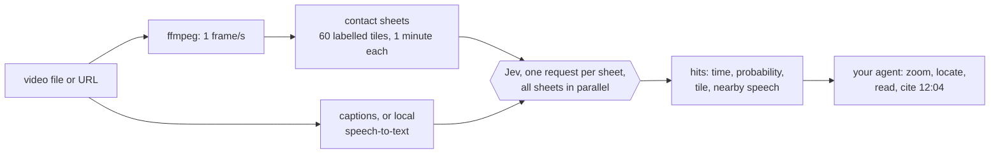

# jevreel

**Search and understand video without embeddings.**

jevreel lays a video out on labelled contact sheets, one frame per second and sixty frames to an
image, and has [Jev](https://docs.typesafe.ai), TypeSafe's fast decision model, judge every sheet in
parallel. Your agent (Claude Code, Codex, Cursor, Claude Desktop, anything that speaks MCP) gets
back moments, times and probabilities, then looks closer itself.

A real run, summarized (the CLI prints JSON):

```text
$ jevreel ask 53bb34 "the car drives across a big steel truss bridge"
hits      2:04 (p=0.99)   5:02 (p=0.98)
spent     11 requests · 84k input tokens · $0.0035 for 10 minutes of 1080p video
```

[](https://github.com/Madhav2609/jevreel/actions/workflows/ci.yml)
[](LICENSE)


## Why no embeddings

- **Your question, not a fixed notion of "similar".** An embedding index decides at index time what
  counts as close. A decision model judges the question you ask now, and returns a probability your
  code can threshold, sort and gate on.
- **Every second, cheaply.** Jev charges for input tokens only, and output is free. A contact sheet
  is sent once and every question about it rides along in the same request, so jevreel screens the
  whole video at one frame per second instead of a handful of keyframes.
- **The expensive model only sees what passed.** Your agent gets the few moments that matter,
  re-rendered at full resolution, rather than a pile of thumbnails.

## How it works



1. **Index.** Sample the video at 1 fps and tile the frames onto 1568 px contact sheets, each tile
   labelled `T01`, `T02`, and so on. Fetch captions, or transcribe locally. Ask every sheet a fixed
   set of questions once (people, on-screen text, cuts, setting, activity, a representative frame),
   which gives a typed timeline.
2. **Ask.** One request per sheet: a yes/no (Noul) for "is it in this minute" plus a Choice over tile
   IDs for "which second". Screen and speech are separate questions combined in code. Borderline
   sheets are asked again with tiles moved and options reordered.
3. **Look closer.** `zoom` re-renders full-resolution frames; `locate` puts a Box around a target in
   one frame and crops it; `whole` answers one question about the entire video from a storyboard,
   the timeline and the transcript.

This follows TypeSafe's own patterns. Their line-search cookbook pairs a Choice over labelled units
with a Noul for "is it there at all". Their images guide finds things in a large image by Choice over
tiles before using Box. Their Box guide gates every box behind a Noul and checks its edges.

## Quickstart

You need Python 3.11+, [FFmpeg](https://ffmpeg.org/download.html) on your PATH, and a
[TypeSafe API key](https://console.typesafe.ai).

```bash
uv tool install "jevreel[all] @ git+https://github.com/Madhav2609/jevreel"
export TYPESAFE_API_KEY=...

jevreel index talk.mp4                       # prints the video id
jevreel ask talk "a slide with a bar chart"  # id, id prefix, path or title all work
jevreel zoom talk 12:00 12:10                # full-resolution frames to look at
```

`[all]` adds URL support (yt-dlp) and local speech-to-text (faster-whisper). Without them, jevreel
indexes local files and uses `.srt` or `.vtt` captions saved next to the video.

## Use it from your agent

The MCP server exposes eight tools. The skill teaches agents the workflow: ask, zoom in before
claiming anything, cite times.

**Claude Code**

```bash
claude mcp add jevreel -e TYPESAFE_API_KEY=your-key -- uvx --from "jevreel[all] @ git+https://github.com/Madhav2609/jevreel" jevreel mcp
```

**Codex**

```bash
codex mcp add jevreel --env TYPESAFE_API_KEY=your-key -- uvx --from "jevreel[all] @ git+https://github.com/Madhav2609/jevreel" jevreel mcp
```

**Claude Desktop, Cursor and other `mcpServers` clients**

```json
{
  "mcpServers": {
    "jevreel": {
      "command": "uvx",
      "args": ["--from", "jevreel[all] @ git+https://github.com/Madhav2609/jevreel", "jevreel", "mcp"],
      "env": { "TYPESAFE_API_KEY": "your-key" }
    }
  }
}
```

VS Code uses the same entry under `"servers"` with `"type": "stdio"`.

**The skill** (Claude Code, Codex and other agents that read Agent Skills):

```bash
npx skills add Madhav2609/jevreel
```

Agents without MCP can use the skill with the CLI alone; every command prints JSON.

## Tools

| MCP tool | CLI | What it does |
| - | - | - |
| `index_video` | `jevreel index` | Sheets, transcript and typed timeline. Runs as an MCP background task; repeat calls return the cache. |
| `ask_video` | `jevreel ask` | Moments matching a description, with times, probabilities, nearby speech, and tile thumbnails. `mode`: visual, speech, both. |
| `find_in_video` | `jevreel find` | Every moment the subject of a reference photo appears. |
| `locate_in_frame` | `jevreel locate` | Box and crop a target in one full-resolution frame. |
| `zoom_video` | `jevreel zoom` | Evenly spaced full-resolution frames between two times. |
| `video_transcript` | `jevreel transcript` | What is said between two times. |
| `ask_whole_video` | `jevreel whole` | One typed answer (yes/no, choice, or score) about the entire video. |
| `list_videos` | `jevreel list` | Videos indexed on this machine. |

`jevreel measure <video>` reports what one contact sheet costs at several grid sizes on your account.

## Python

```python
import asyncio
from jevreel import Reel


async def main() -> None:
    async with Reel() as reel:
        video = await reel.index("talk.mp4")
        result = await reel.ask(video.id, "a slide with a bar chart")
        for hit in result.hits:
            print(hit.time, hit.probability, hit.transcript)
        frames = reel.zoom(video.id, result.hits[0].at - 2, result.hits[0].at + 2, count=3)


asyncio.run(main())
```

## Configuration

| Variable | Default | Meaning |
| - | - | - |
| `TYPESAFE_API_KEY` | (required for Jev) | Your TypeSafe key. Indexing without a timeline, zoom and transcripts work without it. |
| `JEVREEL_HOME` | your user cache folder | Where indexed videos, sheets and crops are kept. `jevreel home` prints it. |
| `JEVREEL_MODEL` | `jev-1.14.0` | Pinned on purpose: Box and image tiles need 1.14, and aliases move. |
| `JEVREEL_FPS` | `1` | Frames per second sampled onto sheets (up to 5). |
| `JEVREEL_TILES_PER_SHEET` | `60` | Frames per sheet. Fewer means larger tiles and more requests. |
| `JEVREEL_CONCURRENCY` | `16` | Parallel Jev requests. Rate limits are per TypeSafe account. |
| `JEVREEL_ASR_MODEL` | `small` | faster-whisper model for videos without captions. |
| `JEVREEL_CAPTION_LANGUAGES` | `en,en-orig,en.*` | Caption languages to fetch for URLs, in order. |

## What it costs

Measured on 2026-10-15 with `jev-1.14.0` at $0.042 per million input tokens:

| | Input tokens | Cost |
| - | - | - |
| One full contact sheet (any grid from 4×7 to 8×14) | about 6,000 | $0.00025 |
| Indexing 10 minutes of 1080p video (11 sheets, 14 s wall clock) | 78,000 | $0.0033 |
| One `ask` across those 10 minutes | 75,000–99,000 | $0.003–0.004 |
| `locate` (Box plus edge check) | 5,000 | $0.0002 |
| `whole` (one storyboard request) | 7,600 | $0.0003 |

So one question asked across an hour of video costs about $0.016 at the default grid. Image token
counts are not documented by TypeSafe yet. These are what the API reported. Check yours with
`jevreel measure`.

## Measured on a real video

A 10-minute 1080p gameplay capture, no speech, checked against the sheets by hand:

| Query | Result |
| - | - |
| "the full-screen city map is shown" | 0:09 and 2:20, both correct first appearances. No false hits. |
| "the car drives across a big steel truss bridge" | 2:04 and 5:02, both real bridge crossings. |
| "the game's pause menu is open" | 10:12 found (p=0.89). Two one-second appearances (0:08, 2:19) missed. |
| `locate` "the location name caption" at 5:02 | Boxed and cropped; the crop reads "Fathers Bridge". |
| `whole` "What is this video mostly?" | "a driving sequence in a video game", 0.98. |

Across three queries, no window without the target scored above 0.07. The misses were events
lasting one second, a single tile among sixty. That is the main limit of the default grid (below).

## Limits

- **Events shorter than about a second can be missed.** At 1 fps they may fall between frames. A
  one-second event is one 261 px tile among sixty, and Jev's probability for such a sheet varies
  between runs. The `weak` list in every answer shows windows Jev didn't rule out. Raise
  `JEVREEL_FPS` or lower `JEVREEL_TILES_PER_SHEET` for footage where that matters.
- **No sound beyond speech.** Audio reaches Jev only as transcript text.
- **Jev's image support is experimental.** TypeSafe calls images and Box "dreamer-ready", not
  production-ready, and says limits and accuracy can change between releases.
- **Jev's real image minimum is 280 px per side.** The docs say 256, but the API rejects anything
  smaller than 280 (measured 2026-10-15). jevreel pads every image itself.
- **Probabilities rank well but need tuning.** Thresholds (0.5 to report, 0.7 "strong", re-ask between
  0.35 and 0.7) follow TypeSafe's examples, not measurements on video.

## Contributing

Issues and pull requests are welcome. See [CONTRIBUTING.md](CONTRIBUTING.md). Coding agents should read
[AGENTS.md](AGENTS.md).

## License

[MIT](LICENSE). jevreel is an independent project, not affiliated with TypeSafe AI. Jev is
TypeSafe's model and is used through its public API under TypeSafe's terms.
